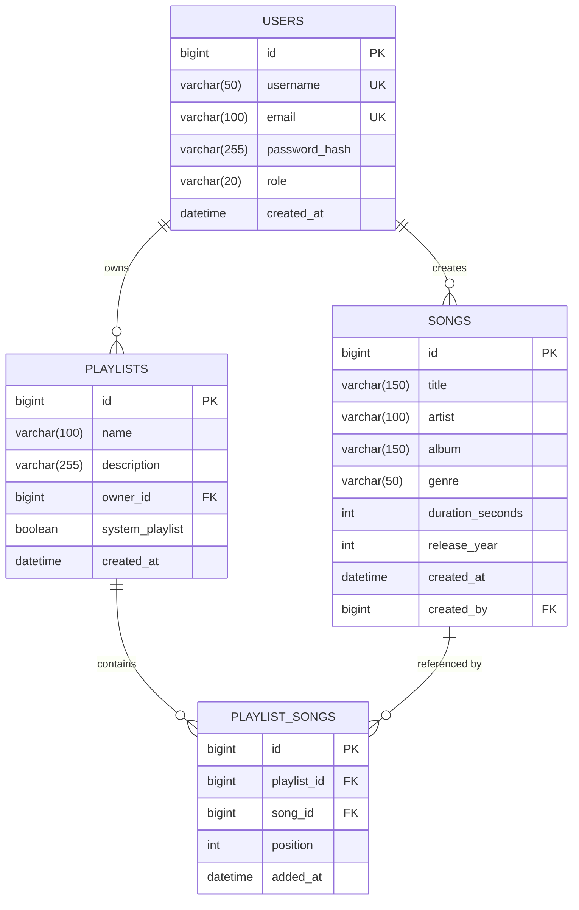

# Music Platform Backend & Architecture

A production-ready Spring Boot music streaming and management platform built on Java 21, Spring Boot 4.1.2, Spring Security, Spring Data JPA, Flyway, and MySQL (with H2 in-memory mode for rapid, isolated testing).

---

## 1. Technology Stack & Dependencies

- **Spring Boot 4.1.2** (Java 21 LTS)
  - Modular starters: `spring-boot-starter-webmvc`, `spring-boot-starter-thymeleaf`, `spring-boot-starter-data-jpa`, `spring-boot-starter-security`, `spring-boot-starter-validation`
  - Database & Migrations: `spring-boot-starter-flyway` + `org.flywaydb:flyway-mysql`
  - In-Memory Testing: `com.h2database:h2` + `spring-boot-h2console`
  - Test Modules: `spring-boot-starter-webmvc-test`, `spring-boot-starter-data-jpa-test`, `spring-boot-starter-security-test`, `spring-boot-starter-flyway-test`
  - Quality & Coverage: `jacoco-maven-plugin` (0.8.14) bound to the `verify` lifecycle phase.

---

## 2. Configuration Profiles

| Profile | Target Database | Flyway Migration Locations | DDL Auto | SQL Logging |
| :--- | :--- | :--- | :--- | :--- |
| **`dev`** | MySQL (`localhost:3306/music_platform`) | `classpath:db/migration,classpath:db/seed` | `validate` | `true` |
| **`test`** | H2 in MySQL Mode (`jdbc:h2:mem:testdb;MODE=MySQL`) | `classpath:db/migration` (No seed) | `validate` | `true` |
| **`prod`** | Managed Cloud MySQL (Strict credentials required) | `classpath:db/migration` (No seed) | `validate` | `false` |

### Environment Variables (.env)
Copy `.env.example` to `.env` to configure your local or deployment environment variables:
```bash
cp .env.example .env
```

---

## 3. Cloud Database SSL Configuration (Requirement D)

In production (`application-prod.yml`), credentials must be supplied via environment variables (`DB_URL`, `DB_USER`, `DB_PASS`) with no default fallback.

### A. Aiven for MySQL
Aiven requires an encrypted SSL connection:
```properties
DB_URL=jdbc:mysql://<aiven-host>:<port>/<dbname>?sslMode=REQUIRED
DB_USER=<aiven-username>
DB_PASS=<aiven-password>
```

### B. TiDB Cloud (Serverless & Dedicated)
TiDB Cloud requires TLS with identity verification:
```properties
DB_URL=jdbc:mysql://<tidb-host>:4000/<dbname>?sslMode=VERIFY_IDENTITY&ssl-mode=REQUIRED
DB_USER=<prefix>.<username>
DB_PASS=<tidb-password>
```

---

## 4. Production Admin Promotion (Requirement B)

User registration via web forms strictly assigns `ROLE_USER`. The user role is never exposed or bound from input forms.

To promote an existing user to an administrator in production, execute this one-line SQL statement directly against the database:

```sql
UPDATE users SET role = 'ROLE_ADMIN' WHERE username = 'target_username';
```

---

## 5. Development Seed & Default Credentials

The dev seed file (`src/main/resources/db/seed/R__01_seed_dev_data.sql`) is completely **idempotent** (`ON DUPLICATE KEY UPDATE`) and safe to re-run across checksum updates:

- **Demo User:**
  - Username: `demo_user`
  - Password: `Password123!` (BCrypt hash: `$2a$10$BEkHPt9.QsL8KRD74oq5M.FR6ZCRWdQgrbMchSjVi1OLKl2i8X/lK`)
  - Role: `ROLE_USER`
  - Includes: Default system playlist `"Favourites"` (`is_system_favourites = TRUE`) and seeded tracks.
- **Dev-Only Admin:**
  - Username: `admin`
  - Password: `Password123!`
  - Role: `ROLE_ADMIN`

---

## 6. Build, Verification & Testing

### Running Tests
Execute unit and smoke tests against H2 MySQL mode:
```powershell
.\mvnw.cmd test
```

### Running Full Verification (JaCoCo Check Bound to `verify`)
Execute the full Maven lifecycle including code compilation, unit tests, integration smoke tests, packaging, and JaCoCo coverage check:
```powershell
.\mvnw.cmd verify
```

### Starting the Application Locally
```powershell
.\mvnw.cmd spring-boot:run
```

---

## 7. Entity Relationship Model (Exactly 4 Entities)

The schema adheres strictly to the 4-entity specification with compound unique constraints, proper foreign keys, cascade rules, and indexes:



### Database Constraints & Indexes:
- `uk_playlist_owner_name (owner_id, name)`: Prevents duplicate playlist names per user and prevents custom playlists named "Favourites".
- `uk_playlist_song (playlist_id, song_id)`: Prevents duplicate songs inside any playlist.
- `fk_song_creator (created_by -> users.id)`: Sets creator reference (ON DELETE RESTRICT).
- `fk_ps_playlist (playlist_id -> playlists.id ON DELETE CASCADE)`.
- `fk_ps_song (song_id -> songs.id ON DELETE CASCADE)`.
- Covering indexes on `(owner_id, system_playlist)` and `(playlist_id, position)`.

---

## 8. Simulated "Now Playing" Player & Fisher-Yates Shuffle

Because this is a metadata-driven music platform (no audio binaries), the playback experience is fully simulated using high-precision web timers:

1. **Timer Driven Playback:**
   - Playback advances every 1 second based on `durationSeconds`.
   - The elapsed playback seconds and current track index are synchronized with browser `sessionStorage`.
   - On page refreshes or navigation across catalog/playlist views, the bottom player automatically rehydrates from `GET /api/queue/state` and resumes playback smoothly.
2. **Auto-Advance & Queue Transitions:**
   - When a track's elapsed time reaches `durationSeconds`, the player calls `POST /api/queue/next` to advance to the next track automatically.
   - Previous (`POST /api/queue/prev`), Next, and direct track switching from the sliding Queue drawer are supported.
3. **Unbiased Fisher-Yates Shuffle:**
   - Shuffling uses an injected `java.util.Random` bean (deterministic `Random(42L)` in test profile, non-deterministic `new Random()` in production).
   - Operates in $O(N)$ time with zero statistical bias.
4. **Session-Only Storage & Deleted Track Handling:**
   - Active queue state is kept in the user's `HttpSession` storing lightweight `QueueItemDto` / `PlayQueueStateDto` records (never JPA entities).
   - If a queued song is deleted by an admin or creator while queued, `cleanDeletedSongs()` safely prunes the record from the session queue during state access.

---

## 9. REST & AJAX API Endpoints

All AJAX endpoints return **HTTP 401 JSON** (`{"status":401,"error":"Unauthorized","message":"Authentication required"}`) if accessed without an authenticated session, rather than redirecting to `/login`.

### A. Favourites Endpoints

#### 1. Toggle Favourite Track
- **URL:** `POST /api/favourites/toggle`
- **Params:** `songId` (long)
- **Headers:** `X-CSRF-TOKEN: <csrf-token>`
- **cURL:**
  ```bash
  curl -X POST "http://localhost:8080/api/favourites/toggle?songId=1" \
       -H "Cookie: JSESSIONID=<session-cookie>" \
       -H "X-CSRF-TOKEN: <token>"
  ```
- **Response (200 OK):**
  ```json
  {
    "songId": 1,
    "favourited": true,
    "message": "Added to favourites"
  }
  ```

#### 2. Get Favourite Status
- **URL:** `GET /api/favourites/status?songId=1`
- **Response (200 OK):**
  ```json
  {
    "songId": 1,
    "favourited": true
  }
  ```

### B. Play Queue Endpoints

#### 1. Get Current Queue State (Rehydration)
- **URL:** `GET /api/queue/state`
- **Response (200 OK):**
  ```json
  {
    "currentSong": {
      "songId": 1,
      "title": "Bohemian Rhapsody",
      "artist": "Queen",
      "album": "A Night at the Opera",
      "genre": "Rock",
      "durationSeconds": 354,
      "formattedDuration": "05:54"
    },
    "queue": [...],
    "currentIndex": 0,
    "shuffled": false,
    "activePlaylistId": 10,
    "activePlaylistName": "Classic Rock",
    "totalTracks": 12
  }
  ```

#### 2. Play Playlist
- **URL:** `POST /api/queue/play-playlist?playlistId=10&shuffle=true`

#### 3. Play Individual Song
- **URL:** `POST /api/queue/play-song?songId=5`

#### 4. Next & Previous Track
- **URL:** `POST /api/queue/next`
- **URL:** `POST /api/queue/prev`

#### 5. Add / Remove Track from Queue
- **URL:** `POST /api/queue/add?songId=8`
- **URL:** `POST /api/queue/remove?index=2`
- **URL:** `POST /api/queue/clear`

---

## 10. Docker Compose Setup

To spin up a local MySQL 8 database with persistent data volume:

```bash
docker compose up -d
```

This starts MySQL on `localhost:3306` with database `music_platform`, user `root`, and password `rootpassword` (matching default development environment configurations in `.env.example`).

